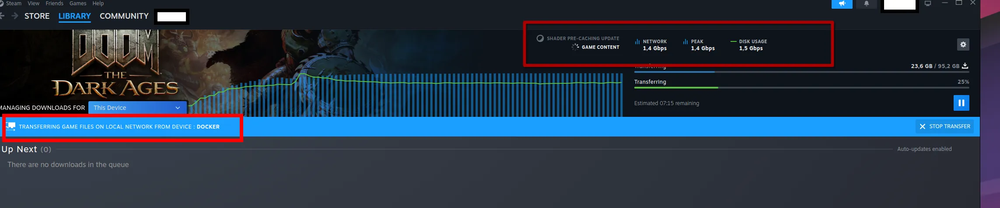

# steam-gui: a LAN game cache built on the Steam desktop client

A Docker image that runs the regular Steam desktop client inside
[jlesage/baseimage-gui](https://github.com/jlesage/docker-baseimage-gui)
(TigerVNC + Openbox, with a noVNC web UI). It does one job: **download, cache
and update games** so other PCs on your network can fetch them through Steam's
**Local Network Game Transfers** instead of the internet.

It is not meant for playing or streaming games. It does not need a GPU, but it
can use an AMD/Intel GPU or iGPU for a smoother UI if you pass one in (see "GPU
or software rendering").

- Web UI: `http://<container-ip>:5800`, VNC: `<container-ip>:5900`
- Persistent data: `/config` (Steam client, login, settings)
- Game libraries: any container path you mount, e.g. `/mnt/games`

On another PC, a finished setup looks like this. That PC is pulling the game
from this container over the LAN, at about 1.4 Gbit/s. The blue bar names the
source **DOCKER**, which is the container `hostname` in the compose example.
The red boxes mark that source and the transfer rate.



## Quick start

Pull the image GitHub Actions publishes to GitHub Container Registry:

```sh
docker pull ghcr.io/pat-e/steam-gui-docker:latest
```

Or build it yourself (`steam-gui:local`):

```sh
./build.sh                                  # builds steam-gui:local
# or: IMAGE_TAG=you/steam-gui:latest ./build.sh
```

```sh
cp docker-compose.example.yml docker-compose.yml
# edit docker-compose.yml: replace every <...> placeholder, pick ONE network option
# image: is ghcr.io/pat-e/steam-gui-docker:latest, or steam-gui:local if you built it
docker compose up -d
```

Open the web UI. On the first start Steam downloads its client (a few hundred MB)
into `/config`, then shows the login window.

## First-run steps

1. **Read the one-time notice and click OK.** It reminds you of step 3 and is
   not shown again. It is tracked by `/config/.steam-gui/focus-notice-acknowledged`;
   set `STEAM_GUI_FOCUS_NOTICE=0` to skip it.
2. **Log in** with the QR code (Steam mobile app) or with your password plus Steam
   Guard. The session is stored in `/config`, so this survives restarts and
   image rebuilds.
3. **Settings > Interface > Enable context menu focus compatibility mode: ON.**
   This is required. Openbox sends an unfocus event before each click, so without
   this setting, clicks on drop-down and right-click menus land on the window
   underneath. (Steam stores this setting in its embedded browser's localStorage,
   key `EnableContextMenuBlurDelay3`. That store is a LevelDB database the image
   cannot safely pre-seed, so you turn it on once by hand.) It takes effect
   immediately, no restart needed.
4. **Container name on your LAN:** other Steam clients show this machine by its
   hostname (for example as the source in their download queue). Set
   `hostname:` in the compose file (the example uses `docker`), otherwise
   Docker uses a random container ID like `3f2a9c1b7d4e`. With
   `network_mode: host` this is ignored and the host's own name is shown.
   The screenshot at the top is that name on the other PC.
5. **Settings > Downloads:**
   - *Game File Transfer over Local Network*: on.
   - *Allow transfers from this device to*: **Only me**, so only PCs logged in to
     your own account can pull games. Choose *Steam Friends* or *Anyone* only if
     you mean it.
   - *Shader Pre-Caching > Allow background processing of Vulkan shaders*: **off**.
     This machine never runs games, so this only burns CPU. You can also turn
     off shader pre-caching entirely.
   - **Without a GPU:** also make sure *Settings > Interface > Enable GPU
     accelerated rendering in web views (requires restart)* is **off**. In GPU
     mode, leave it on. In software mode the container already starts Steam with
     `-cef-disable-gpu -cef-disable-gpu-compositing`. Turning the setting off
     makes the choice stick in Steam's own config too.
6. **Settings > Storage:** add your library (see below), then install the games
   you want cached. Steam keeps installed games updated on its own.
6. On every other PC, enable *Game File Transfer over Local Network* too. Those
   PCs then fetch installs and updates from this container when it has the files.

## Game libraries

### In Steam's UI (default)

Settings > Storage > *Add Drive* > *Let me choose another location*, then pick
the mounted folder (e.g. `/mnt/games`). The image includes `xdg-desktop-portal`
and `xdg-desktop-portal-gtk` plus a private D-Bus session bus, so Steam can show
a folder picker. (See "Known limitations" if the picker shows up empty.)

### Automatically from the environment (optional)

```yaml
environment:
  STEAM_LIBRARY_PATHS: "/mnt/games,/mnt/games2"
```

Before Steam starts, each listed container path that exists and is not yet in
Steam's `libraryfolders.vdf` is added under the next free index. The script
reuses the `contentid` from the folder's own `libraryfolder.vdf` if one exists,
or creates that file if not. Paths already listed are left alone, so this is safe
to keep set. The default is empty, so nothing is touched. On a brand-new
`/config`, registration waits until Steam has installed itself: log in once,
then restart the container.

### With a one-shot command (optional)

```sh
docker exec steam-gui add-steam-library /mnt/games "Games"
docker restart steam-gui
```

Steam rewrites its library list when it exits, so you cannot edit it while
Steam is running. `add-steam-library` only queues the path in
`/config/.steam-gui/pending-libraries`. The next Steam start applies it, before
Steam launches. Restart the container to apply it now (with
`KEEP_APP_RUNNING=1`, *Steam > Exit* also works). Paths that are not mounted
stay queued and are retried on the next start.

### Network-mounted libraries (SMB/NFS/rclone)

These work, with caveats:

- **Permissions:** the container runs Steam as `USER_ID:GROUP_ID`, which must be
  able to create files and directories and to rename and set timestamps on the
  share. Steam also writes and runs a small test script (`.steam_exec_test.sh`)
  in the library root, so don't mount with `noexec`. For SMB, map ownership with
  `uid=`/`gid=` (or `forceuser`) to match.
- **Locking and renames:** Steam stages updates and renames files into place.
  SMB without proper locking, or rclone without `--vfs-cache-mode full` (or at
  least `writes`), can cause failed or corrupted updates and endless "validating".
- **rclone mounts:** the mount must be visible inside the container. Mount it
  on the host with `--allow-other` and bind it in with
  `:/mnt/games:rshared`, or Docker sees an empty directory. Set the container to
  start after the mount (e.g. `restart: unless-stopped` together with a systemd
  dependency on the mount).
- **Performance:** downloads, update patching and serving LAN transfers are I/O
  heavy. Gigabit SMB/NFS is fine; high-latency or cloud-backed mounts are slow
  at patching and verifying.
- If the share is missing when Steam starts, Steam marks the library as
  unavailable. Fix the mount and restart the container.

## GPU or software rendering

The image works both ways and picks the mode on every start (`STEAM_GPU=auto`):

- **Software (default, no GPU):** if no `/dev/dri/renderD*` node exists, or the
  app user cannot open it, Steam runs with `LIBGL_ALWAYS_SOFTWARE=1` (Mesa
  llvmpipe) and `-cef-disable-gpu -cef-disable-gpu-compositing`. Turn off *Enable
  GPU accelerated rendering in web views* in Steam (see first-run steps).
- **GPU (AMD/Intel with open-source drivers: amdgpu, i915/xe):** pass the
  device and add the app user to the host's `render` group:

  ```yaml
  devices:
    - /dev/dri:/dev/dri
  environment:
    SUP_GROUP_IDS: "<render-gid>"   # on the host: getent group render | cut -d: -f3
  ```

  The render group's id differs between hosts, so look it up on yours.
  Startup then finds a usable render node, leaves out the software-GL settings
  and lets Steam use the GPU. The baseimage's X server also uses the GPU
  (DRI3/GBM). The container log shows which mode was picked
  (`GPU rendering enabled` or `No usable GPU: software rendering`). The
  proprietary NVIDIA driver is not supported by the baseimage.

`STEAM_GPU=on` or `off` forces the mode.

## Privileges

Run the container without `privileged`, without `cap_add: SYS_ADMIN` and without
`/dev/fuse`. None of these are needed to run the client and download or serve
games:

- **`/dev/fuse`** is not used. The Steam client, its runtime and this image
  mount no FUSE filesystems. (`xdg-document-portal` would use FUSE, but only
  for Flatpak apps; its failure is harmless.)
- **`SYS_ADMIN`** mainly serves to unlock namespace syscalls in Docker's
  default seccomp profile. Disabling seccomp filtering for this container gives
  the same effect without granting the capability.
- **What current Steam does need:** the client starts `steamwebhelper` (the
  UI) inside Valve's *sniper* runtime through pressure-vessel/bubblewrap. That
  creates an unprivileged user namespace and makes mounts inside it. Docker's
  default seccomp profile blocks user-namespace creation without
  `CAP_SYS_ADMIN`, and on AppArmor hosts Docker's `docker-default` profile
  denies `mount`. If either blocks it, the log shows
  `bwrap: No permissions to creating new namespace`, the UI stays black or empty,
  and Steam reports webhelper crashes. `-no-cef-sandbox` alone does **not**
  fix that, because bubblewrap still runs.

Recommended (expected minimum):

```yaml
security_opt:
  - seccomp:unconfined
  - apparmor:unconfined     # only matters on AppArmor hosts (Debian/Ubuntu)
```

Host requirement: unprivileged user namespaces must be allowed. Debian 11+ and
most distributions allow them by default. Ubuntu 23.10+ restricts them with
`kernel.apparmor_restrict_unprivileged_userns=1`. If bubblewrap still fails
there, that sysctl is the cause.

**This is unverified on this exact image.** Test in this order and stop at the
first configuration that works:

1. **No extra options at all:** remove `security_opt`, `cap_add` and
   `/dev/fuse`. Start it and wait until the login window or library appears.
2. **`seccomp:unconfined` only.**
3. **`seccomp:unconfined` + `apparmor:unconfined`** (the recommended default above).
4. If the UI starts but `steamwebhelper` keeps crashing with sandbox errors, add
   `STEAM_EXTRA_ARGS: "-no-cef-sandbox"` (turns off Chromium's own sandbox).
5. If bubblewrap reports `Can't mount proc`, also add `systempaths=unconfined`
   to `security_opt`. Docker's masked `/proc` paths can block a fresh procfs
   mount inside a user namespace.
6. Last resort: your old `cap_add: [SYS_ADMIN]`.

What to check at each step:

```sh
docker compose up -d --force-recreate steam-gui
docker logs -f steam-gui 2>&1 | grep -Ei 'bwrap|namespace|sandbox|webhelper|pressure-vessel'
# Steam's own logs (default /config layout):
docker exec steam-gui sh -c 'grep -Eih "sandbox|namespace|bwrap|crash" \
  /config/.steam/root/logs/webhelper*.txt /config/.steam/root/logs/cef_log.txt \
  /config/.steam/root/logs/console_log.txt 2>/dev/null | tail -n 40'
# Quick userns probe as the app user (ok = namespaces are allowed):
docker exec -u 1000:1000 steam-gui unshare -U true && echo ok   # use your USER_ID:GROUP_ID
```

"Works" means you can log in, open Settings, and start a download. A
"Steam is having trouble / webhelper" dialog or a black window means try the
next step.

(Alternative to `seccomp:unconfined`: a custom seccomp profile, i.e. Docker's
default profile plus `clone`, `unshare` and `setns` allowed unconditionally,
passed as `seccomp=/path/profile.json`. Tighter, but you have to maintain it.)

## Networking

Local Network Game Transfers need the container to be a real host on the LAN.
Docker's default bridge network (NAT) breaks peer discovery.

- **macvlan** (option A in the compose example): the container gets its own LAN
  IP. Note that with macvlan the Docker host itself cannot reach the container
  without an extra macvlan "shim" interface on the host. Other machines can.
- **host networking** (option B): simplest. The container shares the host's IP
  and ports.

### Firewall / ports

Allow these to and from the container's IP (or the host, with host networking):

| Port            | Proto | Purpose                                         |
|-----------------|-------|-------------------------------------------------|
| 27040           | TCP   | Local Network Game Transfers (data)             |
| 27031-27036     | UDP   | Steam LAN discovery (Remote Play / transfers)   |
| 5800            | TCP   | noVNC web UI (LAN only, ideally protected)      |
| 5900            | TCP   | VNC (optional)                                  |

Outbound internet access for Steam (HTTP/HTTPS plus Steam's usual ports) must
also be allowed. Do not expose 5800/5900 to the internet. The web UI is a
logged-in Steam session. See the baseimage docs for `VNC_PASSWORD`, web
authentication and HTTPS.

## Configuration

Public environment variables from the baseimage that are useful here:

| Variable | Recommended | Notes |
|----------|-------------|-------|
| `USER_ID`, `GROUP_ID` | your host user | Owner of `/config` and library files |
| `TZ` | your zone | e.g. `Europe/Berlin` |
| `KEEP_APP_RUNNING` | `1` | Restart Steam if it exits or crashes |
| `DISPLAY_WIDTH`, `DISPLAY_HEIGHT` | e.g. `1600`/`900` | Virtual screen size |
| `SUP_GROUP_IDS` | host `render` gid | Only for GPU mode (`/dev/dri`) |
| `LANG` | `en_US.UTF-8` (default) | The locale is generated in the image |

Image-specific variables:

| Variable | Default | Notes |
|----------|---------|-------|
| `STEAM_LIBRARY_PATHS` | empty | Comma-separated container paths to register before start |
| `STEAM_GPU` | `auto` | `auto`, `on` or `off`: GPU vs software rendering |
| `STEAM_GUI_FOCUS_NOTICE` | `1` | `0` disables the one-time first-run notice |
| `STEAM_EXTRA_ARGS` | empty | Extra Steam arguments. Never `-tenfoot`/`-gamepadui`, because Big Picture cannot serve LAN transfers |

## How it is built

- `Dockerfile`: Debian 13 baseimage with 32-bit libraries, Mesa (software and
  GPU drivers), `steam.deb` from Valve, locales, D-Bus and the GTK desktop
  portal. It includes a workaround for
  the baseimage's `/var/log` symlink, which breaks Debian 13's apt.
- `rootfs/startapp.sh`: sets up the environment, applies optional library
  registrations, starts a session bus, shows the one-time notice, then
  `exec steam -nofriendsui -cef-disable-gpu -cef-disable-gpu-compositing` with
  `LIBGL_ALWAYS_SOFTWARE=1`. Desktop mode only.
- `rootfs/etc/openbox/main-window-selection.xml`: only the main "Steam" window
  is maximised; menus and dialogs float.
- `rootfs/etc/xdg-desktop-portal/portals.conf`: selects the GTK portal backend.
- `rootfs/usr/local/bin/steam-library-register`: the idempotent `libraryfolders.vdf` edit.
- `rootfs/usr/local/bin/add-steam-library`: the `docker exec` helper.
- `tests/test-library.sh`: offline tests for the library logic and `startapp.sh`,
  using a fake Steam binary. Run them with `sh tests/test-library.sh`.
- `.github/workflows/publish.yml`: on every push to `main`, GitHub Actions
  builds `linux/amd64` and pushes `ghcr.io/pat-e/steam-gui-docker`. Tags are
  `latest` (the `main` branch), `sha-<commit>`, and, for a git tag `v1.2.3`,
  `1.2.3` and `1.2`. The workflow checks that `docker pull` works without a
  login. If a new package stays private, set it to Public once in the package
  settings; later pushes keep that setting.

## Known limitations

- The context-menu focus setting cannot be preset (see first-run step 3).
- The folder picker depends on xdg-desktop-portal running on a private session
  bus without systemd. If the picker opens empty or not at all, use
  `STEAM_LIBRARY_PATHS` or `add-steam-library` instead, and check
  `/config/.steam/root/logs/console_log.txt` for
  "desktop portal" messages.
- Steam updates its own client inside `/config`; image rebuilds don't change
  the client version.

## License

[MIT](LICENSE).
