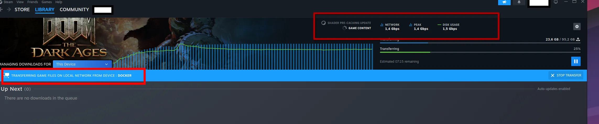
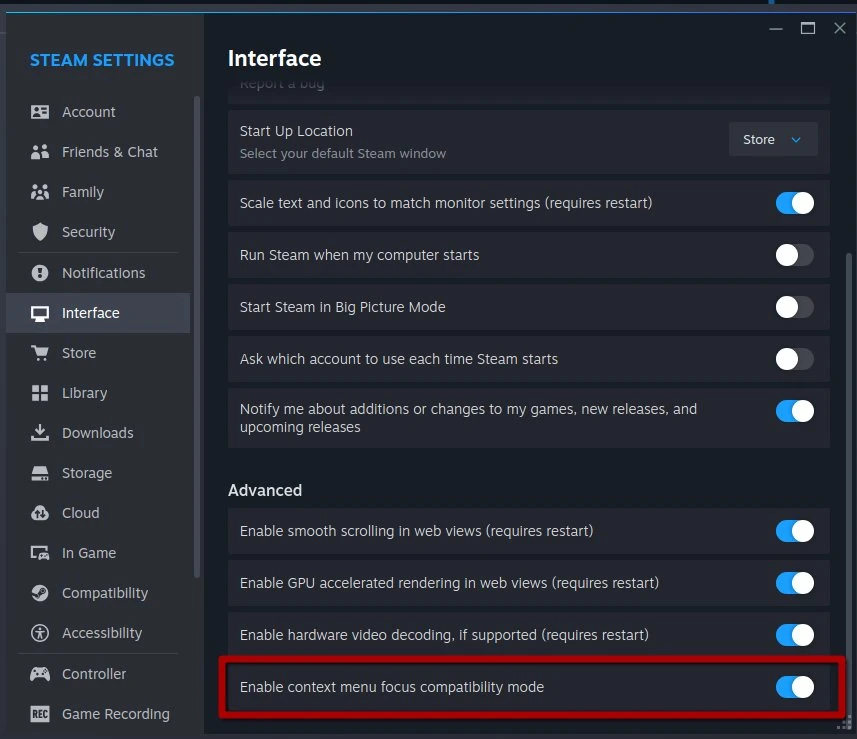

<div align="center">

# steam-cache-server

**A headless-friendly Dockerized Steam desktop client built to cache and serve games over your LAN.**

[](https://github.com/pat-e/steam-cache-server-docker/actions/workflows/publish.yml)
[](https://github.com/pat-e/steam-cache-server-docker/pkgs/container/steam-cache-server-docker)
[](Dockerfile)
[](LICENSE)

*Built on [`jlesage/baseimage-gui`](https://github.com/jlesage/docker-baseimage-gui) (Debian 13 · TigerVNC · Openbox · noVNC)*

</div>

---



<p align="center">
  <sub>A gaming PC pulling <em>DOOM: The Dark Ages</em> from this container over the LAN at ~1.4 Gbit/s. The highlighted banner shows the container's <code>hostname</code> (<code>DOCKER</code>) as the transfer source.</sub>
</p>

## Overview

`steam-cache-server` runs the regular Steam desktop client inside a browser-accessible Docker container with a single job: **download, store, and keep games updated** so other PCs on your network can pull them at LAN speed via Steam's built-in **Local Network Game Transfers**.

- **Zero extra client hacks:** Uses Steam's native LAN transfer protocol — no custom DNS hijacking or caching proxies required.
- **Browser & VNC access:** Manage Steam from any browser via noVNC (`:5800`) or a VNC client (`:5900`).
- **No GPU required:** Runs on software rendering out of the box, with automatic AMD/Intel GPU acceleration if `/dev/dri` is passed through.
- **Flexible storage:** Mount local disks or network shares (SMB, NFS, rclone) and manage libraries via Steam's UI, environment variables, or CLI.
- **Minimal privileges:** No `privileged` mode, no `CAP_SYS_ADMIN`, and no `/dev/fuse`.

> [!NOTE]
> This image is designed strictly as a download and update cache — **not** for playing or streaming games.

---

## Quick Start

### 1. Pull the image (or build locally)

```sh
docker pull ghcr.io/pat-e/steam-cache-server-docker:latest
```

<details>
<summary>Or build the image yourself</summary>

```sh
./build.sh                                            # builds steam-cache-server:local
# Optional custom tag:
IMAGE_TAG=you/steam-cache-server:latest ./build.sh
```

</details>

### 2. Configure Docker Compose

Copy the example file and fill in every `<...>` placeholder:

```sh
cp docker-compose.example.yml docker-compose.yml
```

Key things to customize in `docker-compose.yml`:
- **Image:** Use `ghcr.io/pat-e/steam-cache-server-docker:latest` (or `steam-cache-server:local` if self-built).
- **Hostname:** Set `hostname:` (the example uses `docker`) so other PCs see a recognizable name instead of a random container ID. *(Ignored when using `network_mode: host`, which uses the host's own name.)*
- **Networking:** Enable **either** Option A (`macvlan`) **or** Option B (`network_mode: host`) — see [Networking & Firewall](#networking--firewall).
- **Volumes:** Map `/config` to fast local storage and mount your game library path(s) (e.g. `/mnt/games`).

<details>
<summary>Example: Homelab setup (GPU + local &amp; NAS libraries + macvlan &amp; reverse proxy)</summary>

```yaml
services:
  steam-cache:
    image: ghcr.io/pat-e/steam-cache-server-docker:latest
    container_name: steam-cache
    hostname: docker
    restart: unless-stopped
    shm_size: 512m
    environment:
      - USER_ID=1000
      - GROUP_ID=1000
      - TZ=Europe/Berlin
      - KEEP_APP_RUNNING=1
      - DISPLAY_WIDTH=1600
      - DISPLAY_HEIGHT=900
      - SUP_GROUP_IDS=992                 # host 'render' GID for /dev/dri
    volumes:
      - /path/to/appdata/steam-cache:/config
      - /mnt/nas/steam:/mnt/games         # NAS / NFS library
      - /mnt/local-disk/steam:/mnt/local  # local disk library
    devices:
      - /dev/dri:/dev/dri
    security_opt:
      - seccomp:unconfined
      - apparmor:unconfined
    networks:
      default:                            # reachable by a reverse proxy on the same stack (:5800)
      macvlan_net:
        ipv4_address: 192.168.0.50        # dedicated LAN IP for Steam transfers
```

</details>

### 3. Start the container & open the Web UI

```sh
docker compose up -d
```

Open **`http://<container-ip>:5800`** in your browser (or connect a VNC client to `<container-ip>:5900`). On first launch, Steam downloads its client files (~a few hundred MB) into `/config` and presents the login window.

---

## First-Run Setup

Complete these steps once after opening the Web UI:

1. **Acknowledge the startup notice.** Click **OK** on the one-time setup dialog. *(Tracked by `/config/.steam-gui/focus-notice-acknowledged`; set `STEAM_GUI_FOCUS_NOTICE=0` to skip it.)*
2. **Sign in to Steam** using the Steam Mobile App QR code or your credentials + Steam Guard. Your session persists in `/config` across restarts and image updates.
3. **Enable context-menu focus compatibility mode** *(required — see callout below)*.
4. **Apply recommended Steam settings:**

   | Steam Setting | Recommended Value | Why |
   | --- | --- | --- |
   | **Interface** → *Enable context menu focus compatibility mode* | **ON** *(Required)* | Prevents Openbox menu clicks from falling through to the window behind. |
   | **Interface** → *Enable GPU accelerated rendering in web views* | **OFF** *(software mode)* / **ON** *(GPU mode)* | Matches the container's rendering mode inside Steam's own config. |
   | **Downloads** → *Game File Transfer over Local Network* | **ON** | Enables serving cached games over the LAN. |
   | **Downloads** → *Allow transfers from this device to* | **Only me** | Restricts transfers to your own account *(pick Friends/Anyone only if intended)*. |
   | **Downloads** → *Shader Pre-Caching* → *Background Vulkan processing* | **OFF** | Saves CPU cycles since this container never launches games (you can disable shader pre-caching entirely). |

5. **Add your game library** under **Settings → Storage** (or use one of the automated options in [Game Libraries](#game-libraries)) and install the games you want cached. Steam automatically keeps them updated.
6. **Enable LAN transfers on your gaming PCs** under **Steam → Settings → Downloads → Game File Transfer over Local Network**. They will automatically pull installs and updates from this container whenever it has the files.

> [!IMPORTANT]
> **Why context-menu focus compatibility mode is mandatory:**
> Openbox sends an unfocus event before each click. Without **Settings → Interface → Enable context menu focus compatibility mode** enabled, clicks inside dropdowns and right-click menus pass straight through to the window underneath. Because Steam stores this toggle (`EnableContextMenuBlurDelay3`) inside its embedded Chromium LevelDB `localStorage`, the image cannot safely pre-seed it — you must toggle it once manually. It takes effect immediately with no restart required.

<p align="center">
   Interface showing 'Enable context menu focus compatibility mode' toggled ON under Advanced." width="650">
  <br>
  <sub>Toggle <strong>Enable context menu focus compatibility mode</strong> ON under <strong>Steam Settings → Interface → Advanced</strong>.</sub>
</p>

---

## Networking & Firewall

Steam discovers LAN peers via UDP broadcasts and transfers game data directly over TCP. **Docker's default `bridge` (NAT) network breaks peer discovery**, so the container must appear directly on your LAN using one of two options in [`docker-compose.example.yml`](docker-compose.example.yml):

| Mode | Pros | Notes |
| --- | --- | --- |
| **`macvlan`** *(Option A)* | Gives the container its own dedicated LAN IP and custom `hostname`. | The Docker host itself cannot reach a `macvlan` container without a host-side macvlan shim — unless you also attach a bridge network for a reverse proxy (see below). All other LAN devices can reach it directly. |
| **`network_mode: host`** *(Option B)* | Simplest setup; shares the host's IP and ports directly. | Ignores `hostname:` (uses the host's name). Ensure nothing else on the host binds the ports below. |

### Reverse Proxy + `macvlan` (Dual-Network Setup)

If you already run a containerized reverse proxy (such as Nginx, Nginx Proxy Manager, Caddy, or Traefik) on the same Docker host, you can attach `steam-cache-server` to **both** your `macvlan` network and a regular Docker bridge network (e.g. `default` or your proxy network):

```yaml
networks:
  default:                      # lets a reverse proxy on the same Compose stack reach :5800
  macvlan_net:
    ipv4_address: 192.168.0.50  # dedicated LAN IP for Steam discovery & transfers
```

- **LAN transfers** run over `macvlan_net` using the container's dedicated LAN IP and `hostname`.
- **Web UI access** runs internally over the Docker bridge network (`http://steam-cache-server:5800`) through your reverse proxy — giving you HTTPS, a clean local hostname, and proxy-level authentication without needing a host-side macvlan shim.
- **WebSockets:** Make sure WebSocket support is enabled in your reverse proxy for the noVNC Web UI to connect.

### Required Ports

Allow the following traffic to/from the container IP (or host IP in host mode), alongside normal outbound internet access for Steam:

| Port | Protocol | Purpose |
| --- | --- | --- |
| `27040` | TCP | Steam Local Network Game Transfers (game data) |
| `27031–27036` | UDP | Steam LAN peer discovery |
| `5800` | TCP | noVNC Web UI *(LAN / reverse proxy only)* |
| `5900` | TCP | VNC server *(optional, LAN only)* |

> [!WARNING]
> **Never expose ports `5800` or `5900` to the internet.** Anyone who can reach the UI has access to a logged-in Steam session. Protect access on your LAN using a reverse proxy with HTTPS/auth, or via `VNC_PASSWORD` and baseimage web auth (see the [`jlesage/baseimage-gui` docs](https://github.com/jlesage/docker-baseimage-gui)).

---

## Game Libraries

Mount as many library paths as you want in `docker-compose.yml` — you can freely mix local disks (e.g. `/mnt/local`) and NAS shares (e.g. `/mnt/games`) as separate libraries inside the same container — and register them using whichever method fits your workflow:

### Option 1: Steam UI *(default)*
Go to **Settings → Storage → Add Drive → Let me choose another location** and select your mounted folder (e.g. `/mnt/games`). The image runs a private D-Bus session bus with `xdg-desktop-portal-gtk` so the native folder picker works inside the container.

### Option 2: Environment variable *(automatic on startup)*
```yaml
environment:
  STEAM_LIBRARY_PATHS: "/mnt/games,/mnt/games2"
```
Before Steam launches, any listed container path that exists and isn't already in `libraryfolders.vdf` is registered automatically (reusing an existing `libraryfolder.vdf` `contentid` if present, or creating one). Already-registered paths are untouched, so it is safe to leave set permanently.

> [!TIP]
> On a brand-new `/config` directory, Steam hasn't installed itself yet on first boot. Log in once, then restart the container so `STEAM_LIBRARY_PATHS` can be applied.

### Option 3: One-shot CLI helper
Queue a library path from the host without editing your Compose file:

```sh
docker exec steam-cache-server add-steam-library /mnt/games "Games"
docker restart steam-cache-server
```

Because Steam overwrites `libraryfolders.vdf` on exit, `add-steam-library` queues the request in `/config/.steam-gui/pending-libraries` and applies it on the next Steam startup (restarting the container or choosing **Steam → Exit** when `KEEP_APP_RUNNING=1`). Unmounted paths remain queued and retry automatically on the next start.

<details>
<summary><strong>Using network-mounted libraries (SMB / NFS / rclone)</strong></summary>

Network shares work well if configured with a few Steam-specific requirements in mind:

- **Permissions & execution:** The `USER_ID:GROUP_ID` user must be able to create files/directories, rename files, and update timestamps. Steam also writes and executes `.steam_exec_test.sh` in the library root, so **do not mount with `noexec`**. For SMB, map ownership with `uid=`/`gid=` (or `forceuser`).
- **File locking & atomic renames:** Steam stages updates and renames files into place. SMB without proper locking — or `rclone` without `--vfs-cache-mode full` (or at least `writes`) — can trigger failed updates or endless validation loops.
- **rclone mount propagation:** Mount on the host with `--allow-other` and bind-mount into Docker with `:rshared` (e.g. `/mnt/rclone:/mnt/games:rshared`), otherwise the container sees an empty directory. Ensure the container starts after the mount (e.g. systemd mount dependency + `restart: unless-stopped`).
- **I/O performance:** Patching, verifying, and serving LAN transfers are I/O intensive. Gigabit SMB/NFS works smoothly; high-latency or cloud-backed mounts will be noticeably slower.
- **Missing share at startup:** If a share is offline when Steam launches, Steam marks the library unavailable. Restore the mount and restart the container.

</details>

---

## GPU vs. Software Rendering

By default (`STEAM_GPU=auto`), the container checks for a usable DRI render node on every start and selects the best mode automatically:

- **Software rendering *(default, no GPU)*:** When no accessible `/dev/dri/renderD*` device is present, Steam runs with `LIBGL_ALWAYS_SOFTWARE=1` (Mesa `llvmpipe`) and `-cef-disable-gpu -cef-disable-gpu-compositing`.
- **Hardware GPU rendering *(AMD / Intel open-source drivers: `amdgpu`, `i915`, `xe`)*:** Pass `/dev/dri` and add the container user to your host's `render` group for a smoother UI:

```yaml
devices:
  - /dev/dri:/dev/dri
environment:
  SUP_GROUP_IDS: "<render-gid>"   # find on host: getent group render | cut -d: -f3
```

Check `docker logs steam-cache-server` to verify which mode was chosen (`GPU rendering enabled` vs. `No usable GPU: software rendering`). Set `STEAM_GPU=on` or `STEAM_GPU=off` to force a specific mode.

> [!NOTE]
> Proprietary NVIDIA drivers are not supported by the baseimage. Software rendering is more than sufficient for a download cache.

---

## Configuration Reference

### Image-Specific Environment Variables

| Variable | Default | Description |
| --- | --- | --- |
| `STEAM_LIBRARY_PATHS` | *(empty)* | Comma-separated container paths to auto-register in `libraryfolders.vdf` before Steam starts. |
| `STEAM_GPU` | `auto` | Rendering mode: `auto`, `on`, or `off`. |
| `STEAM_GUI_FOCUS_NOTICE` | `1` | Set to `0` to suppress the one-time first-run setup notice. |
| `STEAM_EXTRA_ARGS` | *(empty)* | Extra CLI flags passed to `steam` (e.g. `-no-cef-sandbox`). **Never** pass `-tenfoot` or `-gamepadui` — Big Picture mode cannot serve LAN transfers. |

### Useful Baseimage Environment Variables

| Variable | Recommended | Description |
| --- | --- | --- |
| `USER_ID`, `GROUP_ID` | Host UID/GID | File ownership for `/config` and mounted game libraries. |
| `TZ` | Your timezone | Container timezone (e.g. `Europe/Berlin`). |
| `KEEP_APP_RUNNING` | `1` | Automatically restarts Steam if it exits or crashes. |
| `DISPLAY_WIDTH`, `DISPLAY_HEIGHT` | `1600` / `900` | Virtual X11 display resolution. |
| `SUP_GROUP_IDS` | Host `render` GID | Required only when passing `/dev/dri` for GPU acceleration. |
| `VNC_PASSWORD` | *(choose one)* | Password-protects the noVNC web UI and VNC port. |
| `LANG` | `en_US.UTF-8` | Locale (pre-generated in the image). |

### Volumes & Container Resources

| Path / Setting | Purpose |
| --- | --- |
| `/config` | Persistent Steam client installation, login session, and settings. **Keep on fast local disk.** |
| `/mnt/games` *(or any path)* | One or more game library directories (local disk or network share). |
| `shm_size: "512m"` | Recommended to prevent Steam's embedded browser (CEF) from crashing on Docker's 64 MB `/dev/shm` default. |

---

## Container Privileges & Security

Run this container **without** `privileged: true`, **without** `cap_add: [SYS_ADMIN]`, and **without** `/dev/fuse`:

- `/dev/fuse` is unnecessary — neither Steam nor this image mounts FUSE filesystems.
- Modern Steam launches its UI (`steamwebhelper`) inside Valve's *sniper* runtime via `pressure-vessel` / `bubblewrap`, which requires creating an unprivileged user namespace and performing mounts inside it. Docker's default seccomp and AppArmor profiles block these syscalls unless loosened.

Recommended baseline in `docker-compose.yml`:

```yaml
security_opt:
  - seccomp:unconfined
  - apparmor:unconfined   # only needed on AppArmor hosts (e.g. Debian/Ubuntu)
```

*(Host requirement: unprivileged user namespaces must be permitted. On Ubuntu 23.10+, `kernel.apparmor_restrict_unprivileged_userns=1` may restrict them.)*

<details>
<summary><strong>Hardening checklist &amp; troubleshooting bubblewrap / webhelper crashes</strong></summary>

If you want to tighten privileges on your specific host — or if you hit a black window / `steamwebhelper` crash — test in this order and stop at the first setup where you can log in, open Settings, and start a download:

1. **No extra options:** Remove `security_opt`, `cap_add`, and `/dev/fuse`.
2. **`seccomp:unconfined` only.**
3. **`seccomp:unconfined` + `apparmor:unconfined`** *(recommended default)*.
4. **Disable Chromium sandbox:** If the UI starts but `steamwebhelper` crashes with sandbox errors, add `STEAM_EXTRA_ARGS: "-no-cef-sandbox"`. *(Note: `-no-cef-sandbox` alone does not fix blocked `bubblewrap` namespaces.)*
5. **Unmask `/proc`:** If `bubblewrap` reports `Can't mount proc`, add `systempaths=unconfined` under `security_opt`.
6. **Last resort:** Add `cap_add: [SYS_ADMIN]`.

*(Advanced alternative to `seccomp:unconfined`: supply a custom seccomp profile based on Docker's default with `clone`, `unshare`, and `setns` allowed unconditionally via `seccomp=/path/profile.json`.)*

**Diagnostic commands:**

```sh
# Recreate container and watch container logs for sandbox/namespace errors
docker compose up -d --force-recreate steam-cache-server
docker logs -f steam-cache-server 2>&1 | grep -Ei 'bwrap|namespace|sandbox|webhelper|pressure-vessel'

# Inspect Steam's own internal logs
docker exec steam-cache-server sh -c 'grep -Eih "sandbox|namespace|bwrap|crash" \
  /config/.steam/root/logs/webhelper*.txt /config/.steam/root/logs/cef_log.txt \
  /config/.steam/root/logs/console_log.txt 2>/dev/null | tail -n 40'

# Verify unprivileged user namespaces work as the app user (replace 1000:1000 with USER_ID:GROUP_ID)
docker exec -u 1000:1000 steam-cache-server unshare -U true && echo ok
```

</details>

---

## Known Limitations

- **Manual context-menu toggle:** The Openbox context-menu focus setting cannot be safely pre-seeded in Steam's LevelDB store (see [First-Run Setup](#first-run-setup)).
- **Folder picker fallback:** Steam's **Add Drive** dialog relies on `xdg-desktop-portal` over a private session D-Bus without systemd. If the dialog opens empty or fails to appear, use `STEAM_LIBRARY_PATHS` or `add-steam-library` instead and check `/config/.steam/root/logs/console_log.txt` for `desktop portal` messages.
- **Self-updating client:** Steam manages its own client binaries inside `/config`, so rebuilding or updating the Docker image does not change the installed Steam client version.

---

<details>
<summary><strong>Under the Hood, Project Layout &amp; CI</strong></summary>

### Repository Layout

| Path | Role |
| --- | --- |
| [`Dockerfile`](Dockerfile) | Debian 13 `jlesage/baseimage-gui` image with 32-bit libraries, Mesa (software + AMD/Intel GPU drivers), Valve's `steam.deb`, locales, D-Bus, and `xdg-desktop-portal-gtk` (includes a `/var/log` symlink workaround for Debian 13 `apt`). |
| [`rootfs/startapp.sh`](rootfs/startapp.sh) | Entrypoint run as `USER_ID:GROUP_ID`: detects GPU/software mode, applies library registrations, starts a private D-Bus session bus, shows the one-time notice, and launches `steam -nofriendsui` in desktop mode. |
| [`rootfs/etc/openbox/main-window-selection.xml`](rootfs/etc/openbox/main-window-selection.xml) | Maximizes only the main Steam window while letting menus and dialogs float freely. |
| [`rootfs/etc/xdg-desktop-portal/portals.conf`](rootfs/etc/xdg-desktop-portal/portals.conf) | Configures `xdg-desktop-portal` to use the GTK backend. |
| [`rootfs/usr/local/bin/steam-library-register`](rootfs/usr/local/bin/steam-library-register) | Idempotent `libraryfolders.vdf` updater used at startup. |
| [`rootfs/usr/local/bin/add-steam-library`](rootfs/usr/local/bin/add-steam-library) | `docker exec` helper to queue new library folders. |
| [`tests/test-library.sh`](tests/test-library.sh) | Offline test suite for library registration and `startapp.sh` using a fake Steam binary. Run with `sh tests/test-library.sh`. |
| [`.github/workflows/publish.yml`](.github/workflows/publish.yml) | Builds `linux/amd64` on pushes to `main` and `v*` tags, attaches build attestations, pushes to `ghcr.io/pat-e/steam-cache-server-docker` (`latest`, `sha-<commit>`, and `1.2.3`/`1.2` for `v1.2.3`), and verifies anonymous `docker pull` works. |

</details>

---

## License

Released under the [MIT License](LICENSE).
